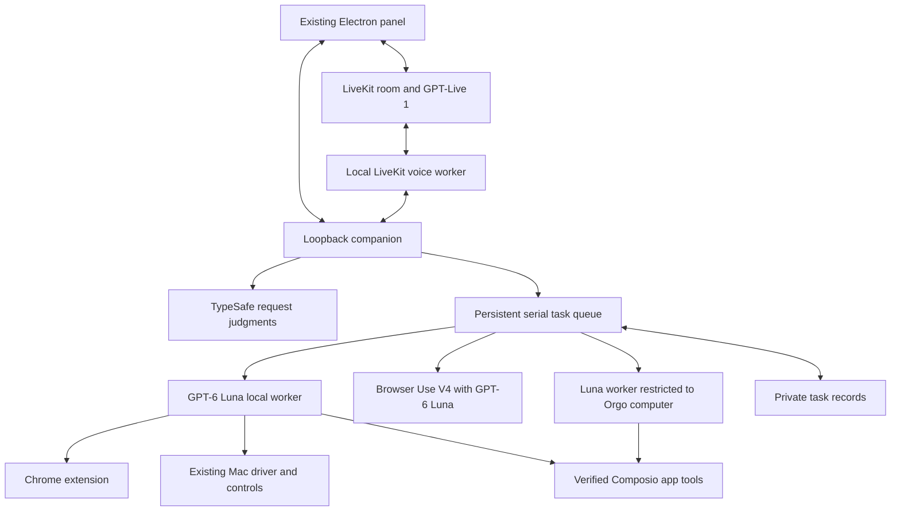

# Implemented architecture — October 27, 2026

Jarvis builds on the Electron desktop app with its local companion and Chrome extension. Version 1.2 adds a separate phone gateway into the same task/voice runtime.

## Desktop and local companion

The original React panel, Electron hotkeys/tray/preload, Chrome protocol, native helpers, DOM grounding, Mac driver and supporting tests are retained in the canonical folder. The new task and voice panels sit inside that interface. The original direct Session path remains behind Instant controls.

Electron runs the companion in-process on loopback. The CLI server is another entry point to the same implementation. The task home is private `~/.jev-assistant`, separate from the old `~/.jev` application data. A process ownership lock prevents two companions mutating that task store. Electron also uses its single-instance lock.

Native app access still requires the existing cua-driver and macOS grants. No cloud-to-local fallback is added. A local worker gets local hands only; it cannot use the old Orgo, co-founder or browser-box services.

## Voice

A separate bundled standalone Node process runs the official LiveKit Agents/OpenAI integration, with GPT-Live 1 in client delegation mode. It starts only when OpenAI and LiveKit configuration exists. Using the actual Node executable avoids native WebRTC class collisions with Electron on macOS; RTC is an explicit production dependency. The agent contains no function-tool registration: delegation events go to the authenticated loopback task service.

The event's pending transcript and bounded recent conversation supply task context. A room is assigned a target by the companion when created. The user can switch the next-task target in the panel during a call; existing tasks keep their original target. The agent cannot choose a different target by changing a delegation request body. Delivery IDs are deduplicated; queued task request IDs survive restarts. Commentary is bounded and returns acknowledgements or terminal task updates to the live model.

The renderer connects microphone/playback directly to LiveKit with a short-lived room-scoped token. It waits for the worker's actual GPT-Live session.started event before enabling microphone capture or declaring a conversation active. Fatal provider errors are classified into quota/authentication/unavailable states without returning raw SDK data; they close the UI session. Every microphone affordance uses this path. Legacy STT/wake capture is disabled in the canonical runtime, and Instant typed controls never changes the voice provider. Provider keys and the local companion token remain server-side. The generated Chrome pairing token is private to its extension folder.

Explicit End conversation disconnects and deletes the room. Idle disconnect, a maximum voice duration, participant-disconnection cleanup and worker shutdown bound connection lifetime. The voice session's end does not cancel the task queue. The voice worker name is isolated by the installation’s private pairing token, so another installation using the same LiveKit project cannot claim its dispatch. See docs/verification.md for the boundaries of automated live-service evidence.

## Models and execution

Local reasoning uses the explicit OpenAI Responses provider and `gpt-6-luna`; the old lead model is off by default. The local worker reuses grounded Chrome and Mac tools, tool approval handling and result observations. It is bounded to 60 steps and 15 minutes per attempt. Reaching a limit saves partial output and pauses the task.

TypeSafe supplies bounded semantic judgments for task status/control/correction routing when connected. Explicit UI target selection and exact known control commands remain code-owned. The retained direct browser/control path still has its original TypeSafe grounding and verification integration. Missing TypeSafe configuration uses the documented limited fallback; it is not shown as a live model connection.

Cloud execution uses Browser Use's V4 hosted agent with explicit Luna/high reasoning, default service tier and a configurable per-run model budget. New sessions use the configured workspace, United States proxy and recording off by default. The app saves acknowledged run/session IDs, event cursors, browser ID and execution deadline. A 15-minute limit cancels the remote run; interruption explicitly stops the owned browser. Successful tasks retain an owned interactive browser for up to 15 minutes for manual browsing and follow-up tasks, subject to provider session limits. A private browser journal enables abandoned-browser cleanup at startup. The viewer uses the provider’s interactive live URL; it never substitutes the local screen. Stop browser and app shutdown close the owned browser. Cleanup requests have independent timeouts, and an unconfirmed stop blocks resume. This is an application execution deadline, not an unsupported agent-run API timeout field. Status is read before the final event drain. A client timeout never triggers a blind repeat dispatch.

The Browser Use hosted agent is an execution boundary of its own. Its instructions cannot provide a hard application-level pre-click approval guarantee. Use reviewed task scope and the provider's actual handoff behavior; workflows needing a hard gate require a controlled executor/API or manual takeover.

## Task records and recovery

Orgo is a third explicit task/voice target, using the same Luna queue worker with local hands removed and only the Orgo own-tool registered. The old co-founder object supports busy checks and the existing live viewer; the new worker does not delegate to the old Hermes agent. Its selected computer is configured separately from the API key. No computer is created, started or stopped during connection setup.

Composio app tools are available to local/Orgo workers when a project key is configured. Account discovery must succeed, and each supported toolkit must have exactly one active identity for the configured user. Tool execution pins that inspected account. Sends and writes use task-bound approval unless the user has enabled the specific API action for that inspected account in Permissions. Remembered grants do not apply to browser clicks, shell commands or Mac control. Initial toolkit actions remain a small named allowlist for Slack, Gmail and ClickUp. Browser Use hosted runs do not receive these tools. Credentials are updated through narrow desktop IPC, not the companion's HTTP API; only configuration flags and nonsecret IDs/URLs are returned. Writes are atomic, mode 0600, and cannot change internal pairing/ports. A restart applies changes and is refused during active tasks or voice sessions.

Tasks are private atomic JSON records, one per task, rather than SQLite in this MVP. Records include target, original/current goal, revision, request ID, timestamps, status, current/partial output, bounded progress history, pending approval, known hosts, and cloud receipt/cursor data. The queue runs one task at a time across both environments.

Local process interruption is persisted as paused. Previously queued tasks without an acknowledged provider run also restart paused for review, preventing old conversation fragments from executing on launch. Resume supplies previous observations and output and instructs the worker to inspect current state before acting. Cloud startup reconnects an acknowledged in-progress run by ID. An uncertain dispatch or stop blocks another dispatch until reconciled. Neither the queue nor arbitrary third-party websites provide a universal exactly-once guarantee.

Task states distinguish queued, running, waiting for a tool approval, paused, worker completed, failed and cancelled. Completion means the worker returned a result, not independent certification of every external effect. Complex multi-step goals can run in one worker attempt; a separate persistent dependency-plan engine is a later feature.

Approval cards and spoken answers are bound to a task and unique current request. Voice offers are refreshed for each new request; duplicate delegation IDs and unoffered answers cannot approve the next action. Explicit corrections update the active task rather than adding another queued task. Broad grants from voice or a task approval are rejected; account-specific API grants are changed only through Permissions. Model confidence is never authorization. Pausing/cancelling aborts the local worker and requests remote cancellation when applicable; effects already in flight require reconciliation.

## Security and packaging

The configured phone gateway uses a separate IPv4 loopback listener (desktop port + 1). A trusted HTTPS tunnel forwards only this listener. Exact Host/Origin checks, non-simple request headers and private device cookies protect an explicit route allowlist. One-use five-minute pairing codes are issued only through desktop-authorized management routes; device hashes/expiry are stored atomically with mode 0600 outside source. Removing a device invalidates its session, drops its Mac-picture state and requests active voice-room deletion, including a recheck after dispatch. Phone clients cannot call internal voice-worker callbacks, change remembered app permissions or open local control sockets. The phone's selected execution target goes to the same queue and existing per-action approvals as desktop requests. In 1.3, local requests receive a fresh Mac observation, voice instructions reflect actual target/capabilities, and the paired HTTP surface adds Mac pictures and explicit human input. Each device owns an independent pictured-window executor; recent-frame IDs and single-use action receipts bind input, active Mac tasks block takeover, and manual input uses foreground delivery. Captures use unique executor file names and are not retained. See docs/phone.md and docs/jarvis-1.3.md.

The companion binds IPv4/IPv6 loopback. New task routes require bearer auth or an exact allowed-origin renderer with a non-simple header. The Chrome bridge always requires its pairing token. Foreign browser origins are rejected.

Electron keeps context isolation and disables Node integration in the renderer. Microphone permission is requested by the actual conversation path, not merely app startup. Main-window navigation stays on the companion origin; external HTTP links open in the user's browser.

The app package excludes `.env` and paired extension credentials. On startup it creates/refreshes a stable private unpacked extension folder. Existing machine endpoints, old deployments and old private credentials were not carried into the new default configuration.

Version 1.3.1 uses a separate primary-display executor for the phone picture/manual controls, rather than depending on window capture that can fail for a dialog or small window. Native PNG dimensions own the input coordinate space; the JPEG preview can be resized independently. Display-scoped click/text/key calls act as the paired human's hands. The local worker has a read-only display-picture fallback when app-window observation fails; other execution targets do not receive that Mac screen capability.

## Future work

After account/audio validation, test real Slack, GoHighLevel and ChatGPT workflows, improve outcome classification and step-level evidence, and measure cost/latency on representative tasks. Test phone audio on physical iPhone hardware. Project dependencies and an always-on host remain future work.
